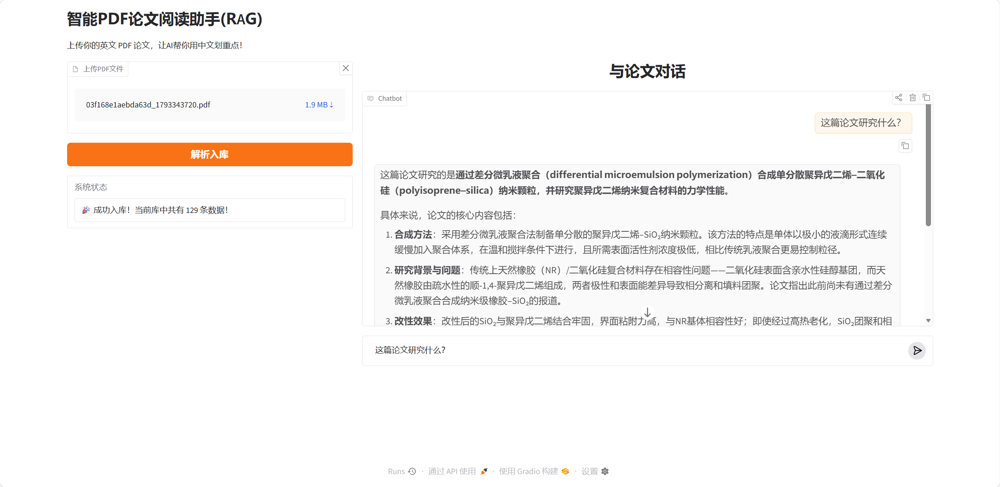

# 📚 SmartPDF-Assistant (智能 PDF 论文阅读助手)

这是一个基于 RAG (检索增强生成) 架构的全栈 AI 应用。专为科研人员和学生打造，旨在解决长篇英文 PDF 论文阅读门槛高、传统大模型“幻觉”（瞎编内容）以及无法处理超长文本的痛点。

## 📸 产品演示 (UI Demo)


*(注：请确保你已经将昨晚跑通的网页截图命名为 ui_demo.png 放在当前文件夹，如果没有，可以暂时删掉这行代码)*

## 🏗️ 核心架构与工作流 (Architecture)

本项目采用**前后端分离**架构，完整实现从文档解析到智能问答的闭环链路：

1. **数据解析层 (PyMuPDF)**：精准提取 PDF 文本，通过正则表达式清洗页眉、页脚等“脏数据”。
2. **切分与向量化 (Chunking & Embedding)**：采用滑动窗口算法（Chunk Size: 500, Overlap: 50）切片，**调用阿里云百炼 `text-embedding-v3` 接口生成 1024 维高维向量**。
3. **向量数据库 (ChromaDB)**：持久化存储文本向量，实现基于“语义”的毫秒级检索。
4. **后端服务 (FastAPI)**：提供高性能 RESTful API，接收提问，检索 Top-4 相关片段，注入 Prompt。
5. **大模型生成 (DeepSeek)**：接入 DeepSeek API，基于检索上下文进行精准中文总结。
6. **前端交互 (Gradio)**：构建可视化对话界面，支持 PDF 上传与智能对话。
7. **容器化部署 (Docker)**：使用 Docker Compose 将前后端打包隔离，一键部署至腾讯云轻量服务器。

## 🛠️ 技术栈 (Tech Stack)

- **语言**: Python 3.10
- **后端框架**: FastAPI, Uvicorn, Pydantic
- **前端框架**: Gradio
- **文档解析**: PyMuPDF (fitz)
- **向量数据库**: ChromaDB
- **大模型 (LLM)**: DeepSeek API
- **向量模型 (Embedding)**: 阿里云百炼 (DashScope) `text-embedding-v3`
- **环境隔离与部署**: Python-dotenv, Docker, Docker Compose

## 🌟 核心难点与踩坑记录 (面试亮点)

在项目落地过程中，我针对真实云服务器环境进行了多次工程化重构：

- **本地模型 OOM 危机与云端重构**：项目初期采用本地 `BAAI/bge-small-zh-v1.5` 模型，但在 2核4G 的低配云服务器上频繁导致内存溢出（OOM）和 Docker 容器假死。**果断重构，将 Embedding 模块替换为阿里云百炼云端 API**，实现后端冷启动从几分钟降至 1 秒内，大幅降低服务器资源消耗。
- **向量维度冲突解决**：替换模型后，因原本地模型输出 512 维向量，而云端 API 输出 1024 维向量，导致 ChromaDB 报 `InvalidArgumentException`。通过彻底清理本地持久化文件 `chroma_db` 并重新建库，成功解决维度不匹配问题。
- **API 并发限制处理**：针对阿里云单次请求文本数量限制，在代码中实现了 Batch 分批请求逻辑（每次 10 条），避免因长文本切片过多导致的接口报错。

## 🚀 快速开始 (Quick Start)

### 1. 克隆代码
```bash
# 1. 克隆你的大仓库
git clone https://github.com/zhangzijun9527/Public.git

# 2. 进入大仓库目录
cd Public

# 3. 进入具体的项目目录
cd AI_app_Projects/smart_pdf_project
