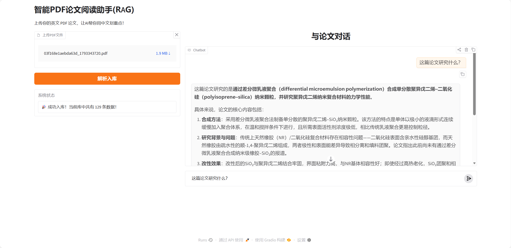

# 📚 SmartPDF-Assistant (智能 PDF 论文阅读助手)

这是一个基于 **RAG (检索增强生成)** 架构的全栈 AI 应用。专为科研人员和学生打造，旨在解决长篇英文 PDF 论文阅读门槛高、传统大模型“幻觉”（瞎编内容）以及无法处理超长文本的痛点。

## 📸 产品演示 (UI Demo)

*(将你刚才那张 7860 端口的网页截图命名为 `ui_demo.png`，放在当前文件夹，替换下面的名字)*



## 🏗️ 核心架构与工作流 (Architecture)

本项目采用**前后端分离**架构，实现了从文档解析到智能问答的完整链路：

1. **数据解析层 (PyMuPDF)**：精准提取 PDF 文本，并通过正则表达式清洗掉页眉、页脚、版权声明等“脏数据”。
2. **切片与向量化 (Chunking & Embedding)**：采用滑动窗口算法（Chunk Size: 500, Overlap: 50）对长文本进行切块，并使用 `BAAI/bge-small-zh-v1.5` 中文向量模型将文本转化为高维向量。
3. **向量数据库 (ChromaDB)**：持久化存储文本向量，实现基于“语义”而非单纯“关键字”的毫秒级检索。
4. **后端服务 (FastAPI)**：提供高性能 RESTful API，接收用户提问，检索 Top-K 相关片段，并注入 Prompt。
5. **大模型生成 (DeepSeek)**：接入 DeepSeek API，基于检索到的上下文进行精准总结，彻底杜绝大模型幻觉。
6. **前端交互 (Gradio)**：构建可视化对话界面，支持 PDF 文件上传、一键解析入库及带溯源展示的智能对话。

## 🛠️ 技术栈 (Tech Stack)

- **语言**: Python 3.13
- **文档解析**: PyMuPDF (fitz)
- **向量化模型**: Sentence-Transformers (bge-small-zh-v1.5)
- **向量数据库**: ChromaDB
- **后端框架**: FastAPI, Uvicorn, Pydantic
- **大模型**: DeepSeek API (OpenAI SDK 规范)
- **前端框架**: Gradio
- **环境隔离**: Python-dotenv (安全加载环境变量)

## 🚀 快速开始 (Quick Start)

### 1. 环境准备
```bash
pip install fastapi uvicorn pymupdf chromadb sentence-transformers openai gradio python-dotenv
