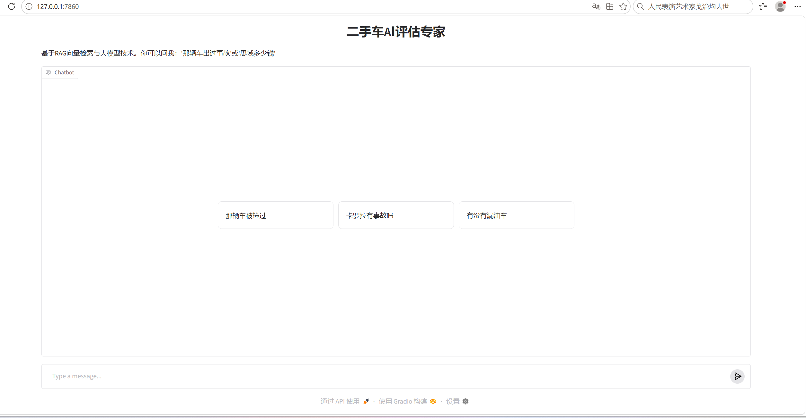

# 🚗 二手车 AI 智能评估与检索系统 (Used Car AI RAG Platform)

这是一个基于真实二手车脏数据构建的**全栈式 AI 应用**。项目打通了从数据清洗、关系型数据库存储、向量语义检索、大模型生成到前端可视化交互的完整数据闭环。

## 📸 产品展示 (UI Demo)

## 🏗️ 核心架构 (Architecture)
1. **数据清洗层**：使用 `Pandas` 对原始 CSV 进行异常值处理与缺失值填充，持久化至 `MySQL`。
2. **向量检索层**：引入 `ChromaDB` 与 `BAAI/bge-small-zh-v1.5` 模型，实现精准语义检索。
3. **后端服务层**：基于 `FastAPI` 提供 RESTful API。
4. **大模型生成层**：接入 `DeepSeek API`，结合 RAG 架构解决大模型幻觉；同时实现 **Text-to-SQL** 自然语言查库。
5. **前端交互层**：使用 `Gradio` 搭建极简聊天界面，支持参考来源溯源。

## 🛠️ 技术栈 (Tech Stack)
- **语言**: Python 3.13
- **数据处理**: Pandas, NumPy, MySQL
- **AI / RAG**: DeepSeek API, ChromaDB, Sentence-Transformers
- **Web 框架**: FastAPI, Uvicorn, Gradio

## 🧠 项目亮点 (Highlights)
- **双引擎检索**：支持文本语义检索（RAG）与结构化精准查库（Text-to-SQL）。
- **防幻觉机制**：强制大模型仅根据检索到的上下文回答。
- **安全规范**：使用 `.env` 环境变量隔离数据库密码与 API Key。
